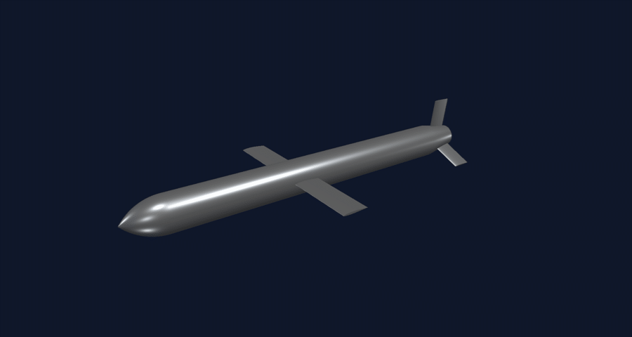
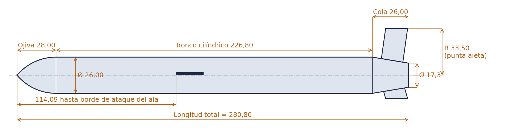
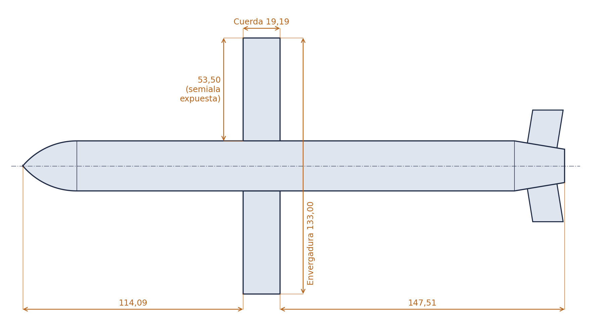
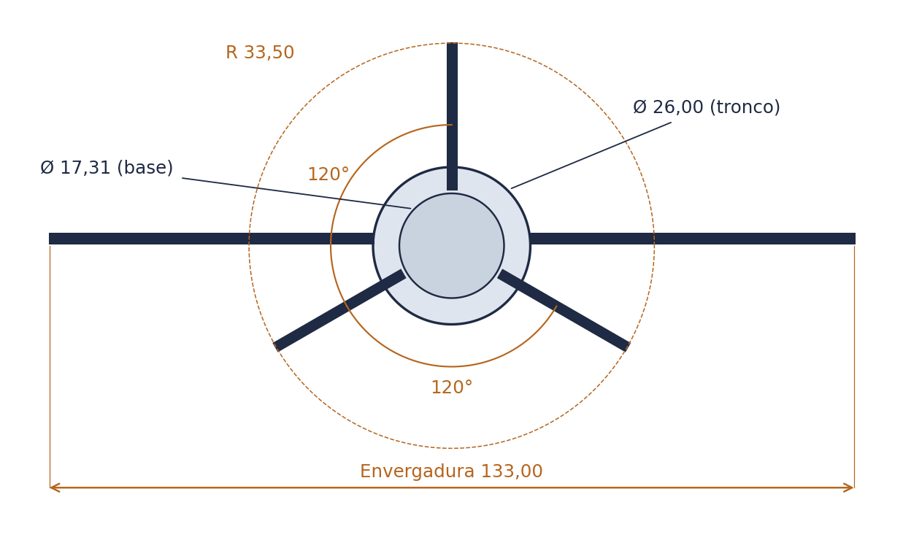
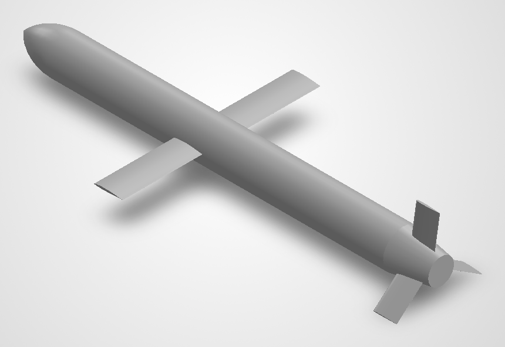
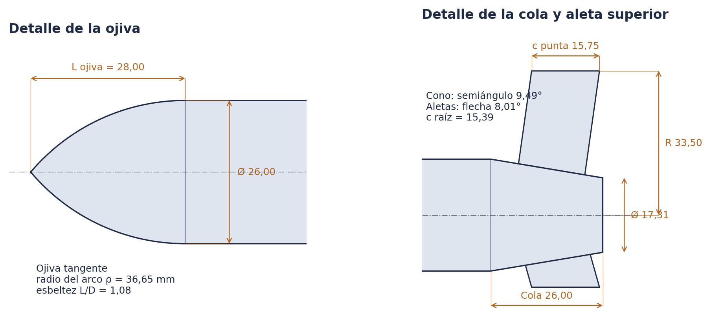
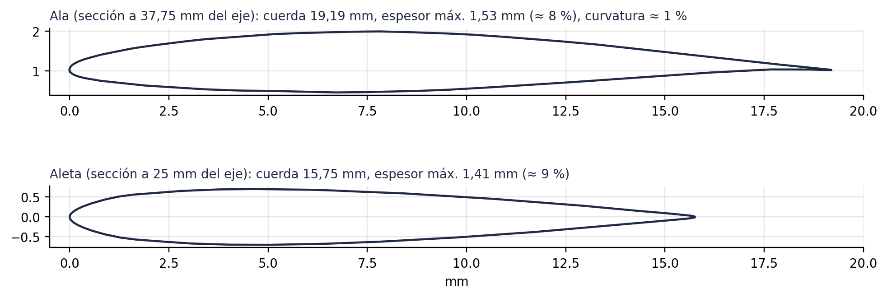

# Misil de crucero Tomahawk · Modelo CAD

Modelo sólido de un misil de crucero tipo Tomahawk a escala ≈ 1:20, diseñado en **SolidWorks 2026** y preparado para simulación aerodinámica (CFD) en **ANSYS Fluent**.

<p align="center">
  
</p>

**Visor 3D interactivo:** `https://<tu-usuario>.github.io/<nombre-del-repo>/` (GitHub Pages)
También puedes abrir [`model/tomahawk.stl`](model/tomahawk.stl) directamente en GitHub: el STL se muestra en un visor 3D integrado.

## Cifras principales

| Longitud total | Diámetro | Envergadura | Esbeltez L/D | Aletas |
|:--:|:--:|:--:|:--:|:--:|
| 280,80 mm | Ø 26,00 mm | 133,00 mm | 10,8 | 3 × 120° |

## Medidas por componente

| Componente | Medidas principales (mm) |
|:--|:--|
| **Ojiva** (tangente) | L = 28,00 · Ø base = 26,00 · radio del arco ρ = 36,65 · L/D = 1,08 |
| **Tronco cilíndrico** | Ø 26,00 · L = 226,80 · de 28,00 a 254,80 desde la punta |
| **Cola troncocónica** | L = 26,00 · Ø 26,00 → 17,31 · semiángulo 9,49° |
| **Alas** (rectas) | envergadura 133,00 · cuerda 19,19 · semiala expuesta 53,50 · espesor 1,53 (≈ 8 %) · borde de ataque a 114,09 |
| **Aletas de cola** (×3, Y invertida) | radio de punta 33,50 · cuerda 15,39–15,75 · flecha 8,0° · espesor 1,41 (≈ 9 %) |
| **Conjunto** | volumen 141,56 cm³ · superficie 286,0 cm² · CdG a 143,33 (51 % de L, sólido homogéneo) |

Medidas extraídas de la geometría exacta (B-rep) del modelo mediante la API de SolidWorks. El informe completo, con todas las vistas y tablas, está en [`docs/Informe_medidas_Tomahawk.pdf`](docs/Informe_medidas_Tomahawk.pdf).

## Planos acotados




<p align="center">
  
  
</p>




## Contenido del repositorio

```
index.html          Página del visor 3D (GitHub Pages)
model/
  tomahawk.step     Geometría exacta (importable en cualquier CAD / ANSYS)
  tomahawk.stl      Malla fina (visor 3D de GitHub)
  tomahawk.glb      Modelo web optimizado (visor, AR)
img/                Planos acotados y capturas de SolidWorks
media/              Animación giratoria
docs/               Informe de medidas en PDF
```

## Publicar el visor

1. Sube el contenido de esta carpeta a un repositorio de GitHub.
2. En **Settings → Pages**, elige *Deploy from a branch*, rama `main` y carpeta `/ (root)`.
3. En unos minutos el visor estará en `https://<tu-usuario>.github.io/<nombre-del-repo>/`.

## Herramientas

SolidWorks 2026 · ANSYS Fluent · Python (API COM de SolidWorks, trimesh, PyVista, matplotlib) · [`<model-viewer>`](https://modelviewer.dev)
